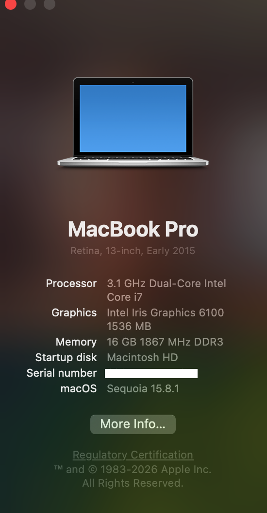

# macOS Legacy Hardware Support & Troubleshooting

A practical IT systems administration project documenting macOS compatibility, OpenCore Legacy Patcher (OCLP), kernel-related dependencies, and hardware troubleshooting.

## Project Overview

This repository documents my hands-on experience running newer macOS versions on older Apple MacBook Pro hardware using OpenCore Legacy Patcher (OCLP).

The main practical exercise involved troubleshooting and restoring Wi-Fi functionality on a 2017 MacBook Pro after installing macOS Tahoe.

The investigation involved identifying an outdated OCLP installation, establishing temporary internet connectivity through Ethernet, upgrading OCLP, downloading the required Kernel Debug Kit (KDK), and completing the necessary post-installation patching workflow.

## Lab Environment

| System | Hardware | Operating System |
|---|---|---|
| System A | MacBook Pro 2015 | macOS Sequoia 15.8.2 |
| System B | MacBook Pro 2017, 13-inch | macOS Tahoe 26 |

## Tools and Dependencies

- OpenCore Legacy Patcher 2.5.1 (initial installation)
- OpenCore Legacy Patcher 3.0.0 Release Candidate 5
- Kernel Debug Kit (KDK) Build 25G342
- Ethernet adapter
- macOS Terminal
- Git and GitHub

## Project Objectives

- Understand macOS compatibility limitations on older Apple hardware.
- Investigate missing Wi-Fi functionality after a macOS upgrade.
- Use Ethernet as an alternative network connection.
- Understand OCLP bootloader and post-installation patching workflows.
- Explore the purpose of the Kernel Debug Kit.
- Restore and verify wireless functionality.
- Document technical findings and troubleshooting procedures.

## Practical Result

**Result: Wi-Fi successfully restored.**

The 2017 MacBook Pro initially booted into macOS Tahoe without functional Wi-Fi.

After updating OCLP, downloading the compatible KDK, and completing the required patching workflow, Wi-Fi functionality returned and remained operational after several restarts.

## Repository Contents

```text
.
├── README.md
├── documentation/
│   ├── macos-tahoe-wifi-restoration.md
│   └── technical-concepts.md
└── screenshots/

## Screenshots and Evidence

This section provides visual evidence from the systems used during the practical troubleshooting exercise.

### System A – MacBook Pro 2015

- **Operating system:** macOS Sequoia 15.8.2
- **Evidence:** System information screenshot.



### System B – MacBook Pro 2017

- **Operating system:** macOS Tahoe 26
- **Troubleshooting outcome:** Wi-Fi functionality was successfully restored using the OCLP post-installation patching workflow.
- **Evidence availability:** The troubleshooting process and outcome are documented in this repository, but a screenshot of System B is not currently included.
